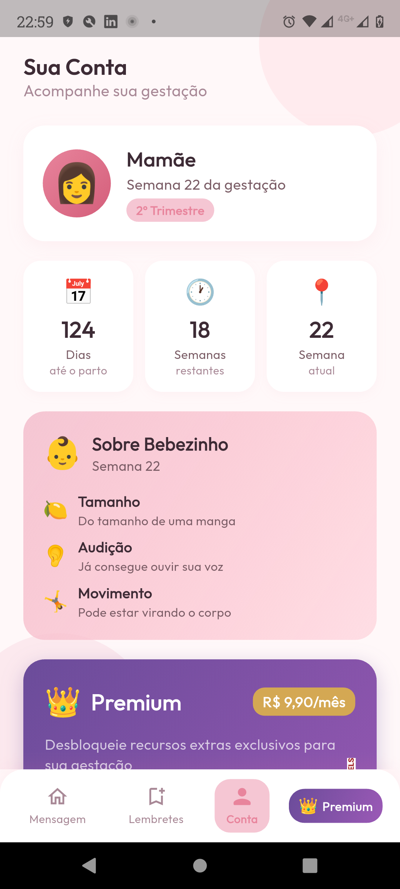

# 🤰 Gestação: Um Dia de Cada Vez — App Mobile Flutter

> **Aplicativo móvel desenvolvido em Flutter para acompanhamento gestacional diário, com interface humanizada, temas dinâmicos e AppWidgets nativos Android.**

[](https://flutter.dev/)
[](https://dart.dev/)
[](https://www.android.com/)
[](LICENSE)

---

## 📌 Visão Geral

O **Gestação: Um Dia de Cada Vez** é uma solução móvel desenhada para proporcionar tranquilidade, apoio informativo e acolhimento para gestantes ao longo de todas as semanas da gravidez. O aplicativo possui múltiplos temas visuais (Floral, Força, Natureza, Noite, Oceano, Serenidade), fluxo de onboarding intuitivo, login, acompanhamento de desenvolvimento fetal e integração com a `API_gestacao`.

---

## 📸 Demonstração Visual

| Tela Mobile em Execução |
|:---:|
|  |

---

## ✨ Funcionalidades Principais

- 🌸 **Paletas Temáticas:** Suporte nativo a temas visuais customizados para refletir estados de espírito da usuária.
- 📅 **Timeline Gestacional:** Acompanhamento interativo da semana atual de gestação com marcos de desenvolvimento do bebê.
- 💡 **Dicas Diárias & Acolhimento:** Mensagens clínicas e afetivas conectadas à base de dados obstétrica.
- 📱 **AppWidgets Android Nativos:** Drawables em XML personalizados (`widget_floral_background.xml`, `widget_oceano_background.xml`, etc.) para exibição na tela inicial do dispositivo.
- 🔐 **Autenticação:** Telas de cadastro e login com validação e consumo de token JWT.

---

## 🛠️ Tecnologias Utilizadas

- **Framework:** [Flutter SDK](https://flutter.dev/)
- **Linguagem:** [Dart](https://dart.dev/)
- **UI & Recursos:** Material Design, Google Fonts, SVGs e vetores XML nativos do Android.
- **Backend Integrado:** [API_gestacao](https://github.com/GabrieldotMasterson/API_gestacao) em Flask + PostgreSQL.

---

## 📁 Estrutura de Pastas

```bash
Gestacao-um-dia-de-cada-vez-flutter/
├── assets/
│   └── screenshots/                 # Capturas da aplicação mobile
│       └── preview.png
├── android/                         # Código nativo e drawables dos widgets
│   └── app/src/main/res/drawable/
│       ├── widget_floral_background.xml
│       ├── widget_natureza_background.xml
│       ├── widget_noite_background.xml
│       └── widget_serenidade_background.xml
├── lib/                             # Código-fonte principal em Dart
│   ├── main.dart
│   ├── screens/                     # Telas de Onboarding, Login e Dashboard
│   └── widgets/                     # Componentes reutilizáveis
├── pubspec.yaml                     # Dependências do Flutter
└── README.md
```

---

## ⚙️ Pré-requisitos

- **Flutter SDK** (3.19 ou superior)
- **Android Studio** com Android SDK ou VS Code com Flutter Extension
- Emulador Android ou aparelho físico conectado

---

## 🚀 Como Executar Localmente

```bash
# 1. Instalar dependências
flutter pub get

# 2. Verificar dispositivos conectados
flutter devices

# 3. Executar o app
flutter run
```

---

## 📄 Licença

Distribuído sob a licença MIT. Consulte `LICENSE` para mais informações.
